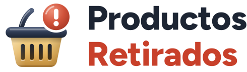
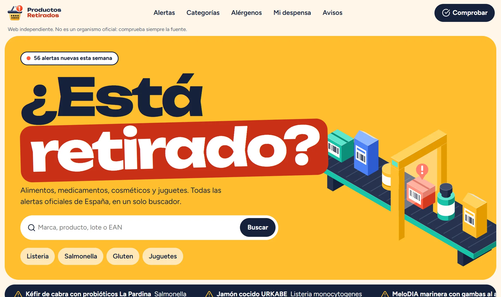
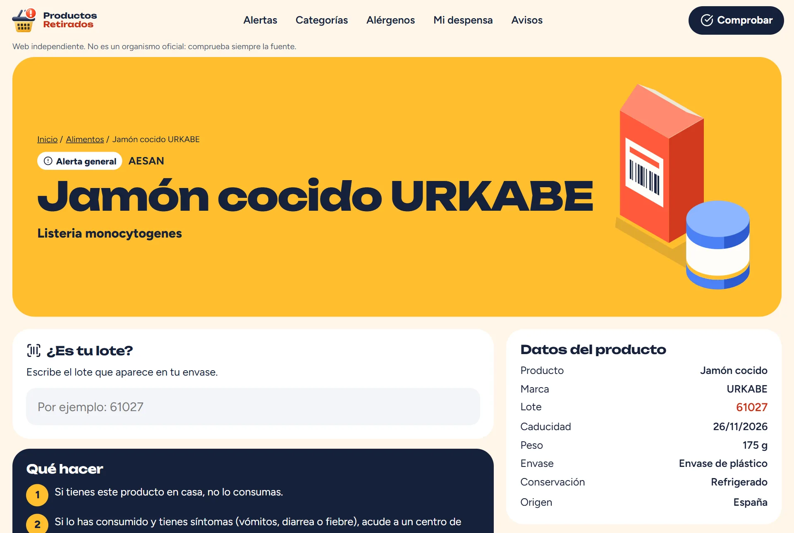
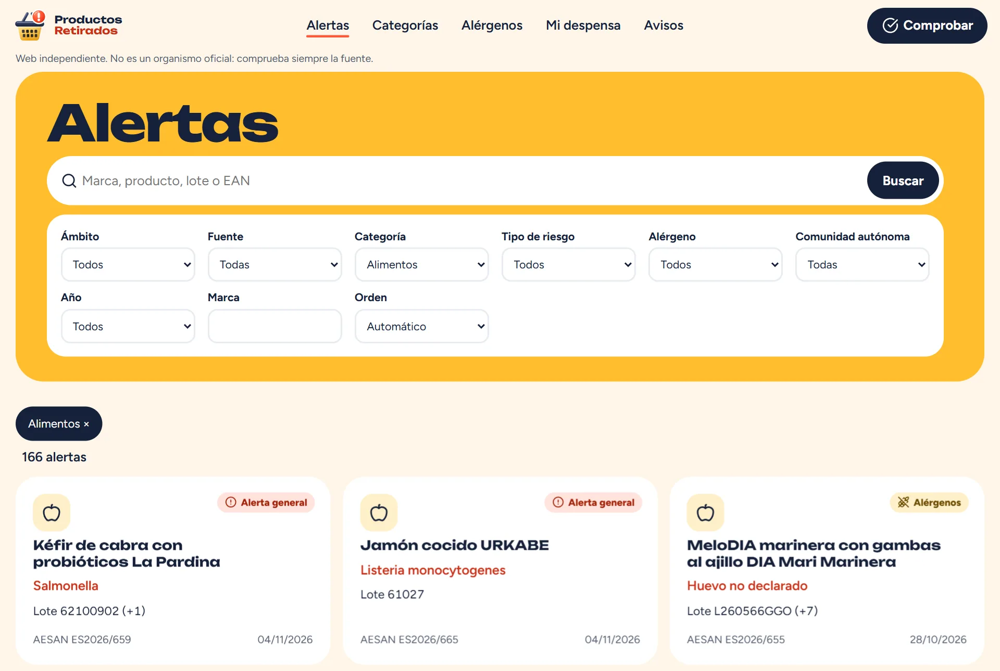
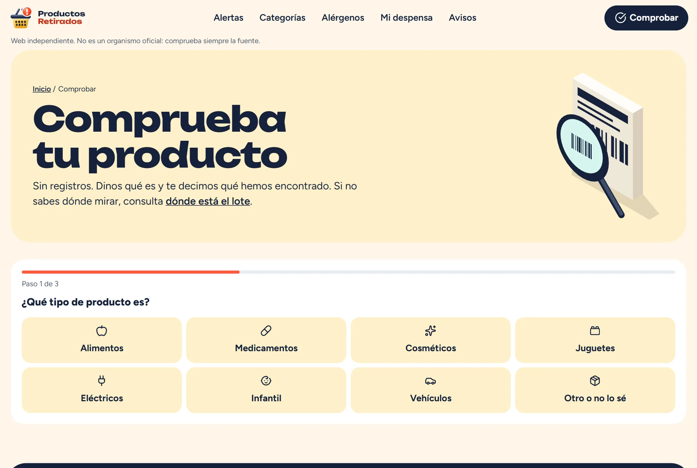
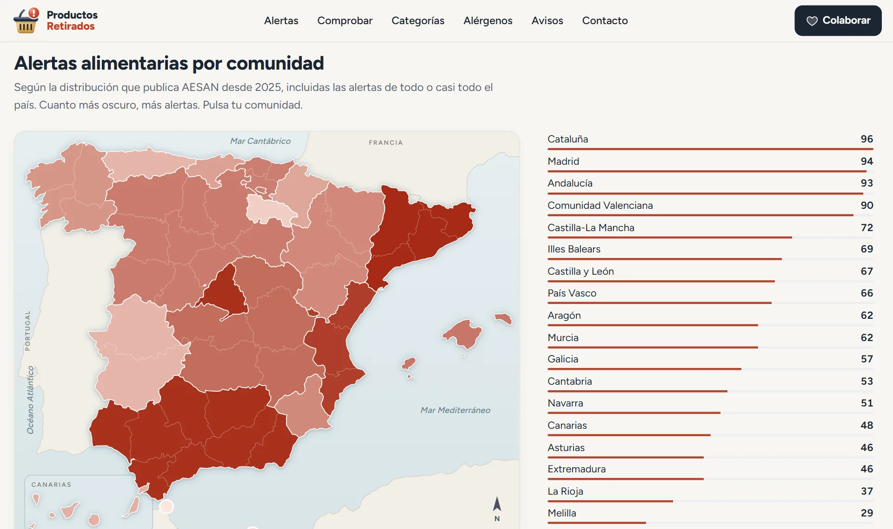
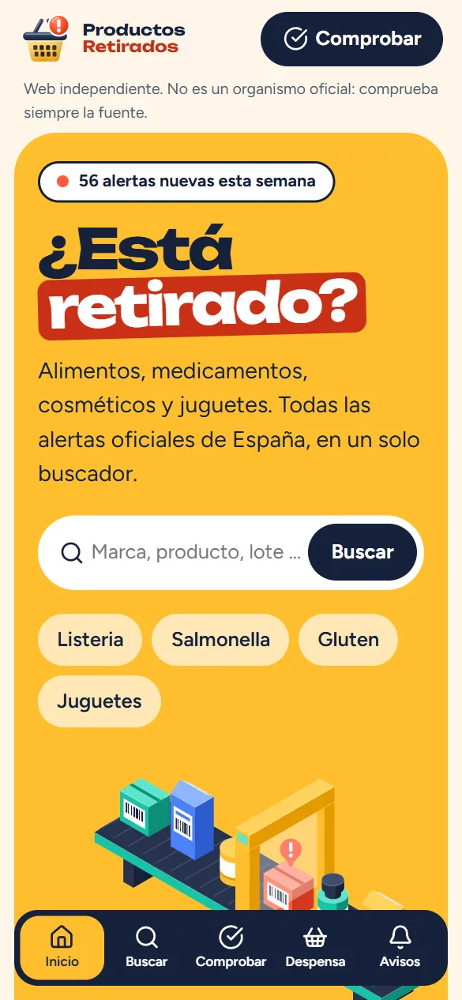
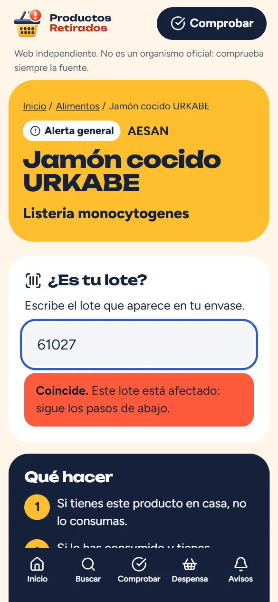
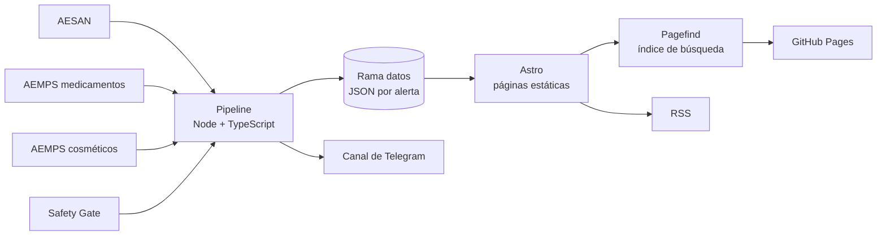

<p align="center">
  <a href="https://ivangarmar22.github.io/ProductosRetirados/">
    
  </a>
</p>

<h3 align="center">¿Está retirado? Compruébalo en segundos.</h3>

<p align="center">
  Todas las alertas oficiales de productos en España, en un solo buscador.<br>
  Alimentos, medicamentos, cosméticos, juguetes y más. Gratis, sin cuentas y sin publicidad.
</p>

<p align="center">
  <a href="https://github.com/ivangarmar22/ProductosRetirados/actions/workflows/actualizar.yml"></a>
  
  
  
  
  
  <a href="LICENSE"></a>
</p>

<p align="center">
  <a href="https://ivangarmar22.github.io/ProductosRetirados/"><b>Abrir la web</b></a> ·
  <a href="https://ivangarmar22.github.io/ProductosRetirados/comprobar/">Comprobar un producto</a> ·
  <a href="https://ivangarmar22.github.io/ProductosRetirados/avisos/">Recibir avisos</a> ·
  <a href="#colabora">Colabora</a>
</p>

<p align="center">
  
</p>

## Qué es

En España, las alertas de productos están repartidas entre varios organismos. Para saber si algo que tienes en casa está retirado hay que saber a quién preguntar y buscar en cada web.

**Productos Retirados** las reúne en un solo sitio: escribes la marca, el producto, el lote o el código de barras y ves si hay alguna alerta, qué hacer y el enlace a la fuente oficial.

> [!IMPORTANT]
> No es un servicio oficial y no evalúa productos: reúne lo que publican las autoridades. **Que un producto no aparezca no significa que sea seguro.** La información con validez es siempre la de la fuente oficial, enlazada en cada ficha.

## Qué ofrece

| | Función | Para qué sirve |
|---|---|---|
| 🔎 | **Buscador con sugerencias** | Marca, producto, lote o EAN, con resultados mientras escribes y corrección de erratas |
| ✅ | **Comprobador en tres pasos** | Tipo de producto, marca o lote, y resultado. Sin registros |
| 📷 | **Fotos del producto** | Las que publican AESAN y Safety Gate, en un visor dentro de la ficha |
| 🏷️ | **¿Es tu lote?** | Escribe tu lote en la ficha y comprueba al momento si coincide |
| 🥜 | **Por alérgeno** | Los 14 alérgenos de declaración obligatoria, con su RSS |
| 🗺️ | **Mapa por comunidad** | Alertas alimentarias por comunidad autónoma y distribución de cada alerta |
| 🔔 | **Avisos** | Telegram, newsletter y RSS general, por categoría y por alérgeno |
| 📊 | **Estadísticas** | Evolución mensual, categorías, riesgos y países de origen |
| 📤 | **Compartir** | Por WhatsApp o copiando el enlace, para avisar a la familia |
| ♿ | **Accesible** | Teclado completo, foco visible, animaciones que se pueden pausar y sin depender del color |

## En cifras

| | |
|---|---|
| **22.335** | alertas publicadas en el buscador |
| **21.720** | de Safety Gate, desde 2020 |
| **381** | de medicamentos de la AEMPS, desde 2016 |
| **182** | de AESAN, desde 2025 |
| **52** | de cosméticos de la AEMPS, desde 2020 |
| **24.798** | páginas estáticas generadas |
| **8** | comprobaciones de las fuentes al día |
| **0** | cookies propias, cuentas, anuncios y servidores propios |

<sub>Datos del 06/11/2026. Las cifras actualizadas están en la página de <a href="https://ivangarmar22.github.io/ProductosRetirados/estado/">estado de las fuentes</a>.</sub>

## Capturas

<table>
  <tr>
    <td width="50%"><br><sub>Ficha con «¿Es tu lote?» y qué hacer</sub></td>
    <td width="50%"><br><sub>Listado con filtros combinables</sub></td>
  </tr>
  <tr>
    <td><br><sub>Comprobador guiado</sub></td>
    <td><br><sub>Mapa por comunidad</sub></td>
  </tr>
</table>

<p align="center">
  
  &nbsp;&nbsp;
  
</p>

## Cómo funciona

No hay backend ni base de datos. GitHub Actions descarga las fuentes cada 3 horas, guarda los datos en la rama `datos` y publica una web estática.



- **Cada fuente va aislada.** Si una falla, conserva su último dato bueno y el fallo se ve en `/estado/`.
- **Scraping respetuoso.** Cumple `robots.txt`, se identifica, espacia las peticiones y guarda caché.
- **Sin inventar nada.** Se muestra solo la gravedad que publica cada fuente y se avisa cuando un dato se ha extraído de texto libre.
- **La búsqueda no engaña.** Pagefind recorta las palabras que no encuentra, así que cada resultado se verifica: un lote casi igual nunca devuelve otro producto.

## Tecnología

| Parte | Elección |
|---|---|
| Web | [Astro](https://astro.build) 7, salida estática |
| Búsqueda | [Pagefind](https://pagefind.app), en el navegador |
| Datos | Node 24+ con TypeScript nativo, [fast-xml-parser](https://github.com/NaturalIntelligence/fast-xml-parser), [node-html-parser](https://github.com/taoqf/node-html-parser) y [Ajv](https://ajv.js.org) |
| Pruebas | [Vitest](https://vitest.dev), [Playwright](https://playwright.dev) y [axe](https://github.com/dequelabs/axe-core) |
| Publicación | GitHub Actions y GitHub Pages |
| Diseño | CSS propio, [Figtree](https://github.com/erikdkennedy/figtree), iconos de [Phosphor](https://phosphoricons.com) y mapa de [Natural Earth](https://www.naturalearthdata.com) |

Calidad medida en local el 06/11/2026: Lighthouse móvil 100 en las cuatro categorías en inicio, listado, categoría, apoyo y tres tipos de ficha; 44 tests de parsers; 41 flujos e2e en móvil, tablet y escritorio; axe sin incidencias, y sin desbordes a 360, 390, 768, 1024, 1280 y 1440 px.

## Desarrollo

Requiere Node 24 o superior.

```bash
npm ci
npm run pipeline     # descarga los datos en data/
npm run build        # compila dist/ y genera el índice de búsqueda
npm run dev          # http://localhost:4321
```

La búsqueda necesita el índice de Pagefind, así que solo funciona después de `npm run build`.

<details>
<summary><b>Comandos</b></summary>

| Comando | Qué hace |
|---|---|
| `npm run dev` | Servidor de desarrollo |
| `npm run build` | Compila la web y el índice de Pagefind |
| `npm run preview` | Sirve la compilación |
| `npm run pipeline` | Descarga y normaliza las fuentes |
| `npm run avisos` | Publica las alertas nuevas en Telegram |
| `npm run tipos` | Comprueba los tipos |
| `npm test` | Tests de parsers con fixtures reales |
| `npm run e2e` | Flujos clave y accesibilidad sobre `dist/` |
| `npm run verificar` | Tipos y tests de parsers |

</details>

<details>
<summary><b>Variables de entorno</b></summary>

Copia `.env.example` a `.env`. Es un sitio estático: aquí no hay secretos.

| Variable | Para qué sirve |
|---|---|
| `PUBLIC_SITE_URL` | URL pública, con subcarpeta si la hay |
| `PUBLIC_TELEGRAM_URL` | Enlace al canal. Si falta, la web dice «muy pronto» |
| `PUBLIC_NEWSLETTER_URL` | Formulario alojado de MailerLite. Si falta, la web dice «muy pronto» |

En GitHub, `TELEGRAM_BOT_TOKEN` y `TELEGRAM_CHANNEL_ID` van como secrets del repositorio.

</details>

<details>
<summary><b>Estructura</b></summary>

```text
pipeline/        Descarga, normalización y avisos
  fuentes/       Un parser por fuente
schema/          Esquema JSON de una alerta
src/
  componentes/   Piezas de Astro
  layouts/       Cabecera, pie y navegación
  lib/           Datos, formato y configuración del sitio
  pages/         Rutas, RSS y sitemap
  scripts/       Buscador, comprobador, desplegables, mapa y efectos
  estilos/       Un único CSS con los tokens de diseño
public/          Marca e iconos
tests/           Parsers y flujos e2e
fixtures/        Páginas reales para los tests
docs/            Investigación, decisiones y lanzamiento
```

</details>

## Despliegue

1. En **Settings → Pages**, elige **GitHub Actions** como origen.
2. Lanza **Actualizar y publicar** desde la pestaña Actions. Después se ejecuta solo cada 3 horas.
3. La web queda en `https://ivangarmar22.github.io/ProductosRetirados/`.

Para pasar a un dominio propio, apunta el DNS a GitHub Pages y define la variable de repositorio `PUBLIC_SITE_URL` con la nueva URL: el `CNAME` se genera solo. La lista completa está en la [guía de lanzamiento](docs/fase-4/lanzamiento.md).

## Limitaciones conocidas

- **Consumo no está incluido.** Sus alertas nacionales esperan a que el Ministerio confirme las condiciones de reutilización.
- **AESAN empieza en 2025**, porque la agencia no mantiene publicadas las anteriores.
- **Safety Gate no siempre indica dónde se vendió un producto.** Se muestran todas las alertas y se avisa cuando no consta su relación con España.
- **Parte de los datos se extrae de texto libre** y puede contener errores. La ficha lo indica.
- **Muchas alertas no publican el código de barras:** si no aparece, hay que buscar por marca o lote.
- **El buscador y el comprobador necesitan JavaScript.** Sin él sigue disponible el listado completo.

## Colaborar

- ¿Has visto un error en una alerta? [Abre una incidencia](https://github.com/ivangarmar22/ProductosRetirados/issues) o escribe a estaretirado@gmail.com.
- ¿Conoces otra fuente oficial con condiciones de reutilización claras? Cuéntalo en una incidencia.
- Para cambiar código, abre una pull request. `npm run verificar` y `npm run e2e` deben pasar.

## Colabora

Productos Retirados es gratuito y lo seguirá siendo. Con tu ayuda iremos mejorando la web e investigando mejores formas de encontrar avisos.

<table>
  <tr>
    <td align="center" width="50%">
      <b>Bizum</b><br><br>
      <code>652 308 536</code><br><br>
      <sub>Con el concepto «Productos Retirados»</sub>
    </td>
    <td align="center" width="50%">
      <a href="https://www.paypal.me/ivangarmar22"></a><br><br>
      <a href="https://www.paypal.me/ivangarmar22">paypal.me/ivangarmar22</a>
    </td>
  </tr>
</table>

Compartir la web con tu familia y avisar de errores ayuda tanto como un donativo.

## Licencias

| Contenido | Licencia |
|---|---|
| Código | [MIT](LICENSE) |
| Datos de AESAN | Reutilización autorizada citando la fuente y la fecha de actualización |
| Datos de la AEMPS | Reproducción autorizada citando su origen y la fecha de actualización |
| Datos de Safety Gate | © Unión Europea. Informes semanales CC0; el resto, CC BY 4.0 |
| Figtree | [SIL Open Font License](docs/licencias/) |
| Iconos de Phosphor | [MIT](docs/licencias/phosphor-MIT.txt) |
| Cartografía de Natural Earth | Dominio público |
| Logotipo | Propio del proyecto |

Las marcas citadas pertenecen a sus titulares. Las fotos de producto no se copian: se cargan desde la web oficial de cada fuente.

---

<p align="center">
  <sub>Hecho con cariño por <a href="https://github.com/ivangarmar22">ivangarmar22</a> para que nadie se entere tarde.</sub>
</p>
